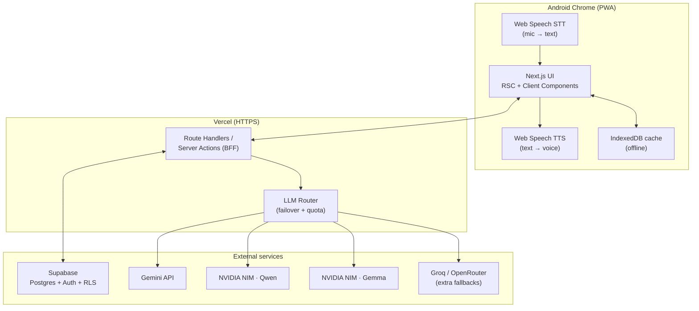
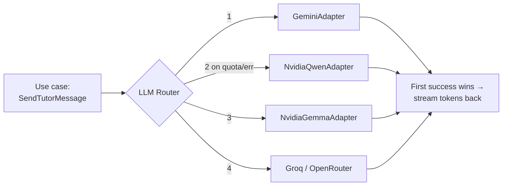
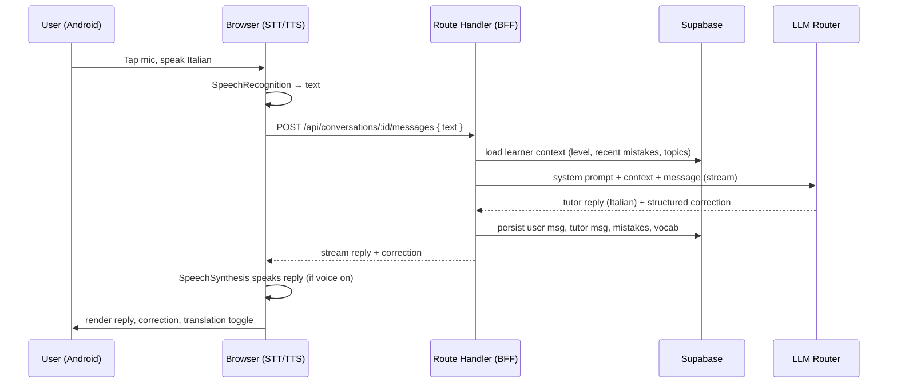

# Architecture & Tech Stack

_Phase 0 document · Last updated: 2026-07-15 · Status: DRAFT for approval_

---

## 1. Guiding principles

- **Clean Architecture**: dependencies point inward. Domain knows nothing about Next.js, Supabase, or any LLM.
- **Ports & adapters**: external services (LLM, STT/TTS, DB) sit behind interfaces so they're swappable and testable.
- **Server-side secrets**: every provider call happens in a Route Handler / Server Action. The browser never sees a key.
- **Typed boundaries**: Zod validates every input/output crossing a trust boundary (HTTP body, LLM JSON, env).
- **Progressive enhancement**: works as a normal web app; PWA + offline cache layered on top.

## 2. Layered model (Clean Architecture)

```
┌─────────────────────────────────────────────────────────────┐
│ Presentation  — React Server/Client Components, shadcn/ui,   │
│                 hooks, TanStack Query, Zustand (UI state)     │
├─────────────────────────────────────────────────────────────┤
│ Application   — use cases: SendTutorMessage, CorrectText,     │
│                 GetProgress, ReviewFlashcards … (orchestration)│
├─────────────────────────────────────────────────────────────┤
│ Domain        — entities & rules: Conversation, Message,      │
│                 Mistake, VocabularyItem, Progress, Learner    │
│                 (pure TypeScript, no I/O)                     │
├─────────────────────────────────────────────────────────────┤
│ Infrastructure — adapters: LlmRouter (+provider adapters),    │
│                 SupabaseConversationRepository, DrizzleSchema, │
│                 WebSpeech STT/TTS, IndexedDB cache            │
└─────────────────────────────────────────────────────────────┘
```

Rule of thumb: **Presentation → Application → Domain**, and Infrastructure implements
interfaces _defined in_ Domain/Application. Application depends on interfaces, never on
Supabase/Gemini directly.

## 3. System context & runtime



- **STT/TTS run in the browser** (free, on-device-ish). The server never handles audio in V1.
- **All model + DB calls run server-side** on Vercel. Keys stay in env vars.
- **IndexedDB** caches conversations for offline reading; Supabase is the source of truth.

## 4. LLM router with failover (core design)

A single port, several adapters, one router that cascades.



Port (defined in domain/application):

```ts
export interface LlmProvider {
  readonly id: string; // "gemini", "nvidia-qwen", ...
  generate(input: LlmRequest): AsyncIterable<LlmChunk>; // streaming
  health(): ProviderHealth; // quota/backoff state
}
```

Router responsibilities:

- Try providers in **configured order**; on `RateLimitError` / `QuotaExceeded` / `ProviderError`, advance to the next.
- Track per-provider quota + a cooldown/backoff window so an exhausted provider is skipped until it recovers.
- Emit structured logs (which provider served, latency, failover reason) — no secrets.
- Deterministic and unit-testable: providers are injected; tests use fakes that throw quota errors.

Order is **config-driven** (env/JSON), so reordering or adding a provider is not a code change.
Default chain: `gemini → nvidia-qwen → nvidia-gemma → groq/openrouter`.

## 5. Conversation & correction flow (V1)



The tutor returns **two things**: the conversational Italian reply (streamed for speed)
and a **structured correction object** (Zod-validated JSON: corrected text, error type,
explanation-in-English, vocab items). Structured output is what powers progress tracking.

## 6. PWA & offline

- Web App Manifest + service worker (via `next-pwa` or a hand-rolled SW).
- **Cache strategy:** app shell precached; conversation reads served stale-while-revalidate from IndexedDB; writes require connectivity in V1 (queued-write sync deferred to V2).
- Install prompt on Android Chrome → home-screen icon, standalone display.

## 7. Security architecture (summary; full detail in API doc)

- **Auth:** Supabase Auth (email/password). Session via Supabase SSR helpers; server verifies the session on every protected Route Handler.
- **Data isolation:** Postgres **Row-Level Security** — every table with user data has a policy `user_id = auth.uid()`. Even a bug in app code can't leak another user's rows.
- **Secrets:** `GEMINI_API_KEY`, `NVIDIA_API_KEY`, `SUPABASE_SERVICE_ROLE_KEY`, etc. live in Vercel env vars (server only). Only `NEXT_PUBLIC_*` (Supabase URL + anon key) reach the client.
- **Validation:** Zod on every request body and on LLM structured output before persistence.
- **Rate limiting:** lightweight per-user limit on the message endpoint to protect free quotas.
- **Transport:** HTTPS everywhere (required anyway for mic).

## 8. Tech-stack decisions (ADR-style)

Each decision = chosen option + why + rejected alternatives.

### ADR-1 — Client/runtime: Next.js full-stack PWA

Chosen because it unifies UI + backend-for-frontend, matches the owner's fullstack skills,
installs on Android as a PWA, and is free to host. **Rejected:** native Kotlin (Android-only
rewrite, slower to iterate for a solo dev), Flutter (Dart, less transferable), KMP (overkill).

### ADR-2 — Hosting: Vercel (Cloudflare Pages as alternative)

Native Next.js host, free HTTPS + public URL (mic requirement), encrypted env vars.
**Rejected:** local + tunnel (laptop must stay on), self-host (ops burden).

### ADR-3 — LLM: multi-provider router with failover

Keeps the app free by cascading across the owner's existing free endpoints. Provider-agnostic
port allows swapping/reordering by config. **Rejected:** single provider (single point of
quota failure), paid-only (violates free constraint).

### ADR-4 — Speech: Web Speech API (STT + TTS)

Free, no server audio handling, good on Android Chrome, Italian voices available.
**Rejected (for V1):** Whisper / cloud STT (cost + server audio pipeline) — kept behind an
interface as a future iOS/quality fallback.

### ADR-5 — DB + Auth: Supabase (+ Drizzle ORM)

Postgres + Auth + RLS in one free service; RLS gives per-user isolation with minimal code —
ideal for 2–3 members. Drizzle keeps the schema in TypeScript and portable.
**Rejected:** Neon + Auth.js (more glue), Clerk + Neon (two vendors), local-first only
(no real multi-user auth/isolation).

### ADR-6 — UI: Tailwind + shadcn/ui

Fast, accessible, themeable (Material-3-like), Dark/Light out of the box, free.

### ADR-7 — Validation: Zod

Single source of truth for types + runtime validation at every boundary (HTTP, LLM JSON, env).

### ADR-8 — Client state/data: TanStack Query + Zustand

Query handles server-state caching/streaming; Zustand for small UI state (theme, voice toggle).
Avoids a heavy global store.

### ADR-9 — Testing: Vitest + Playwright

Vitest for fast domain/application unit tests (incl. router failover); Playwright for one
critical e2e path (sign in → send message → get reply).

### ADR-10 — CI/CD: GitHub Actions + Vercel

Actions run typecheck/lint/test on PR; Vercel builds preview per branch and promotes on merge.

## 9. Cross-cutting concerns

- **Config:** typed, Zod-validated env loader; fail fast on missing keys at boot.
- **Logging:** structured server logs (provider used, latency, failover reason); no PII/secrets.
- **Error handling:** typed domain errors → mapped to HTTP problem responses; UI shows friendly states.
- **Observability (V2):** Vercel Analytics + Sentry free tier for crash reporting.
