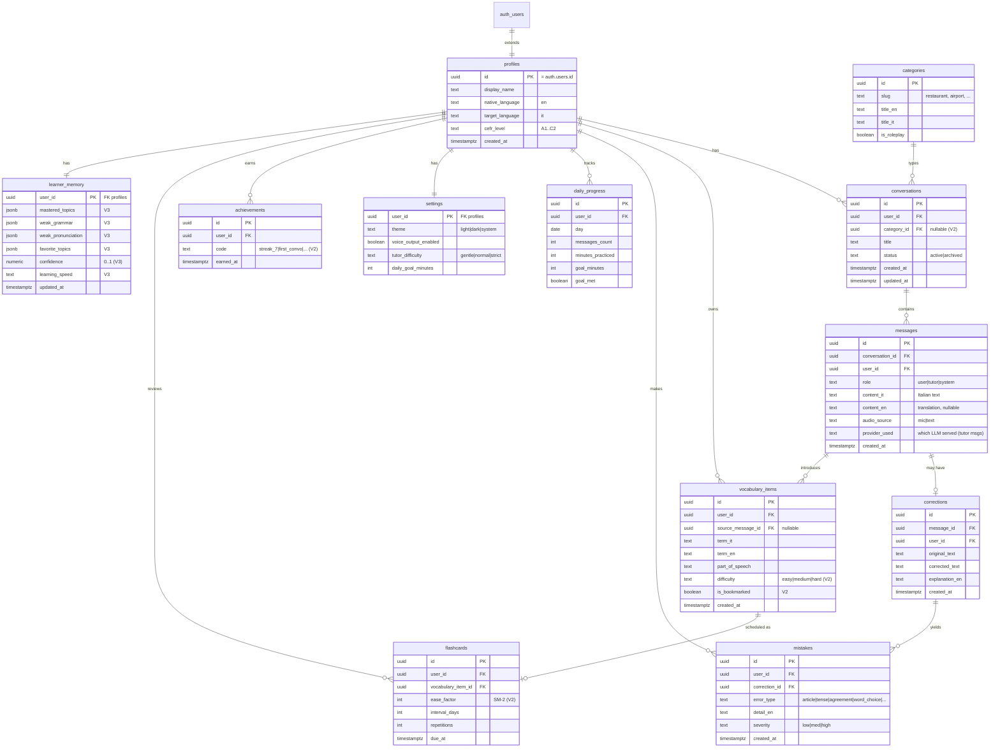

# Database Schema & ERD

_Phase 0 document · Last updated: 2026-07-15 · Status: DRAFT for approval_

Postgres on Supabase. Schema defined in **Drizzle** (TypeScript). Every user-owned table
carries `user_id` and is protected by **Row-Level Security** (`user_id = auth.uid()`).
`profiles.id` is a 1:1 extension of Supabase's `auth.users`.

Scope note: the ERD below covers **V1 + the tables V2/V3 will need**, so the schema is
stable early. V1 only writes to a subset (profiles, conversations, messages, corrections,
mistakes, vocabulary_items, daily_progress, settings). V2/V3 tables are marked.

## 1. ER diagram



## 2. Table notes & relationships

- **profiles (1:1 auth.users):** app-level user data. Created via a trigger/`upsert` on first sign-in. `cefr_level` drives tutor difficulty and vocabulary selection.
- **categories:** seed data for V2 conversation topics (restaurant, airport, hotel, travel, shopping, business, doctor, dating, interview, roleplay…). Nullable FK on `conversations` so V1 conversations work without a category.
- **conversations 1:N messages:** a chat session. `updated_at` powers "recent conversations" and cache invalidation.
- **messages:** stores both `content_it` and optional `content_en` (translation is generated lazily and cached). `provider_used` records which LLM answered (observability). `role` distinguishes user/tutor/system.
- **messages 1:0..1 corrections:** a user message may yield one correction; the tutor's structured output populates it.
- **corrections 1:N mistakes:** one correction can contain several tagged errors → this is the raw signal for V3 adaptivity ("weak in articles").
- **vocabulary_items:** words surfaced during conversation; `is_bookmarked`/`difficulty` are V2.
- **flashcards 1:1 vocabulary_item:** spaced-repetition schedule (SM-2 fields) — V2.
- **daily_progress:** one row per user per day; drives dashboard + streaks.
- **settings 1:1 profiles:** per-user preferences (theme, voice, difficulty, daily goal).
- **learner_memory 1:1 profiles:** V3 persistent memory as `jsonb` (flexible while the adaptivity model evolves); can be normalised later if needed.

## 3. Normalisation

Third normal form for relational data (conversations/messages/corrections/mistakes/vocab).
`learner_memory` intentionally uses `jsonb` for evolving, schemaless adaptivity signals — a
deliberate denormalisation for iteration speed, revisited in V3.

## 4. Row-Level Security (Supabase)

Every user-owned table gets RLS enabled with policies of the form:

```sql
alter table conversations enable row level security;

create policy "own rows - select" on conversations
  for select using (user_id = auth.uid());
create policy "own rows - write" on conversations
  for all using (user_id = auth.uid()) with check (user_id = auth.uid());
```

`categories` is read-only reference data (RLS: allow `select` to authenticated users; no
user writes). This guarantees data isolation for the 2–3 members even if application code
has a bug.

## 5. Indexing (initial)

- `conversations (user_id, updated_at desc)` — recent-conversations list.
- `messages (conversation_id, created_at)` — load a thread in order.
- `mistakes (user_id, error_type)` — V3 "weak areas" aggregation.
- `flashcards (user_id, due_at)` — V2 due-cards query.
- `daily_progress (user_id, day)` unique — one row per day.

## 6. Migrations

Drizzle Kit generates SQL migrations from the TypeScript schema; RLS policies + seed data
(`categories`) live in versioned SQL migration files committed to the repo.
